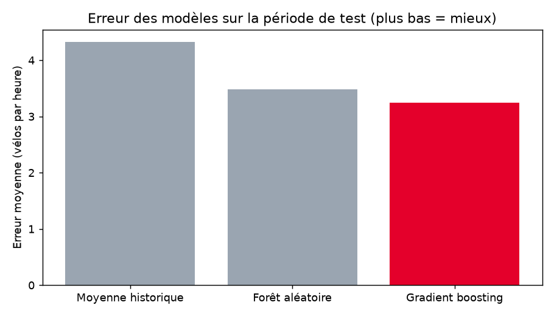
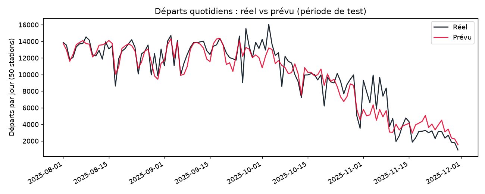
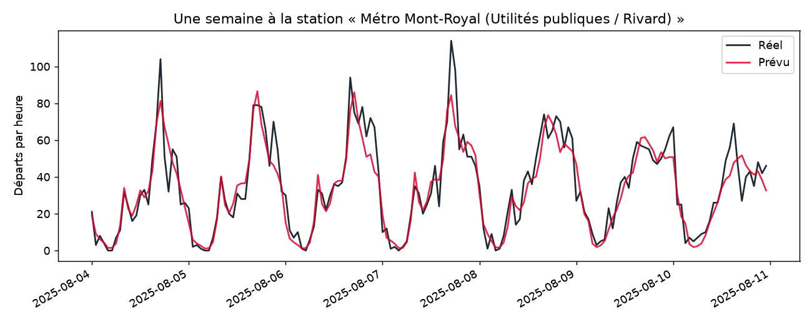
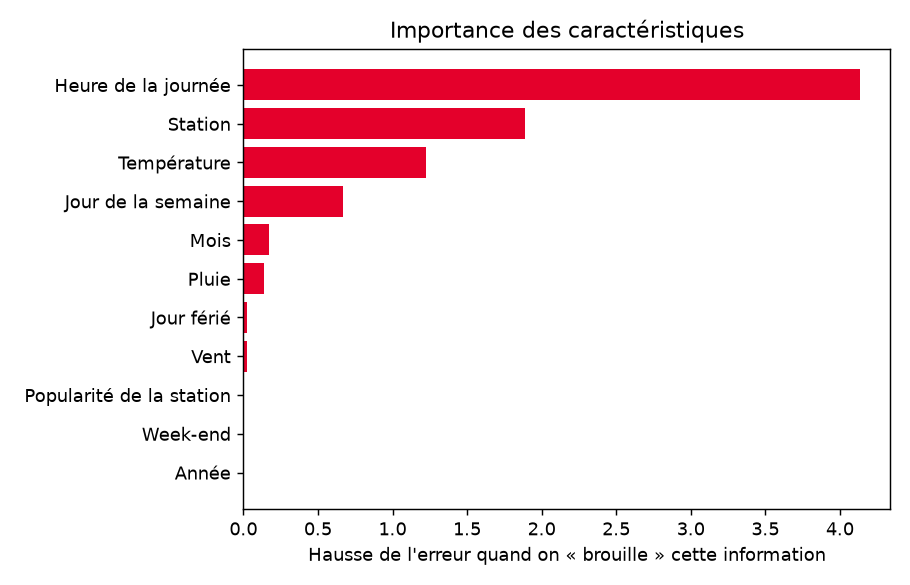

# Résultats

Période de test : du 2025-08-01 au 2025-11-30 (138,240 heures × stations), jamais vue pendant l'entraînement.

| Modèle | Erreur moyenne (MAE) | RMSE | R² |
|---|---|---|---|
| Moyenne historique | 4.33 | 6.56 | 0.555 |
| Forêt aléatoire | 3.49 | 5.25 | 0.715 |
| **Gradient boosting** | 3.25 | 4.95 | 0.747 |

Le meilleur modèle (**Gradient boosting**) se trompe en moyenne de **3.25 départ(s) par heure** (moyenne réelle : 8.82 départs par heure), soit **25 % d'erreur en moins** que la simple moyenne historique.

Les trois informations les plus utiles au modèle : Heure de la journée, Station, Température.

